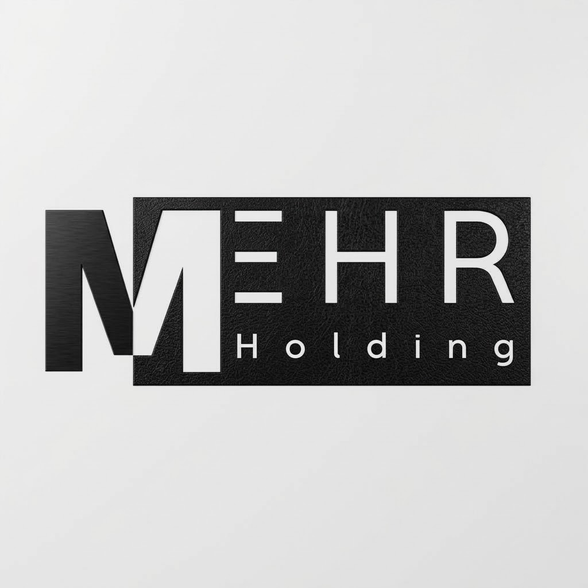

<div align="center">



# 🏢 پنل مدیریت نمایندگی یدک مهر

### سامانه جامع مدیریت نمایندگی، انبار و فروش

[](https://sofiyabahari465-tech.github.io/myshop-panel/)
[](https://myshop-backend-8nu7.onrender.com/api/health)
[]()

</div>

---

## 📋 معرفی

این پروژه یک **پنل مدیریت کامل** برای شرکت **بازرگانی مهر امین (MEHR Holding)** است که شامل مدیریت نمایندگان، انبار، ارسال بار، اعلام فروش، گارانتی و پشتیبانی می‌باشد.

---

## ✨ ویژگی‌ها

### 🔐 پنل ادمین
- 📊 **داشبورد مدیریتی** با آمار کامل
- 👥 **مدیریت نمایندگان** (افزودن، ویرایش، حذف)
- 📦 **مدیریت انبار** همه نمایندگان
- 🚚 **ارسال بار** با آپلود اکسل
- 📈 **گزارش‌های فروش** با چاپ حرفه‌ای
- ↩️ **بررسی درخواست‌های مرجوعی**
- 🛡️ **مدیریت گارانتی** با ارسال پیامک خودکار
- 🎫 **مدیریت درخواست‌های پشتیبانی**

### 🏬 پنل نماینده
- 📊 **داشبورد اختصاصی** با آمار شخصی
- 📦 **مدیریت انبار** شخصی با آپلود اکسل
- 🚚 **مشاهده بارهای ارسالی** با رهگیری وضعیت
- 📈 **ثبت اعلام فروش** در روزهای مجاز
- ↩️ **ثبت درخواست مرجوعی**
- 🛡️ **ثبت درخواست گارانتی** با عکس
- 🎫 **درخواست پشتیبانی**

---

## 🛠 تکنولوژی‌ها

<div align="center">

| Frontend | Backend | Database | Hosting |
|----------|---------|----------|---------|
| React 19 | Node.js | MongoDB | GitHub Pages |
| TypeScript | Express.js | Mongoose | Render |
| Vite 8 | JWT Auth | Atlas | PWA |
| Tailwind CSS 4 | Payamito SMS | | |

</div>

---

## 📱 PWA (وب‌اپلیکیشن)

این پروژه به‌صورت **PWA** ساخته شده و قابل نصب روی موبایل و دسکتاپ است.

- ✅ آفلاین کار می‌کند
- ✅ آیکون اختصاصی (MEHR Holding)
- ✅ نصب روی صفحه اصلی موبایل
- ✅ تجربه کاربری شبیه اپلیکیشن

---

## 🚀 نصب و راه‌اندازی

### پیش‌نیازها
- Node.js 18+
- npm یا yarn

### اجرای محلی
```bash
# نصب وابستگی‌ها
npm install

# اجرای نسخه توسعه
npm run dev

# ساخت نسخه نهایی
npm run build

# پیش‌نمایش نسخه نهایی
npm run preview
```

---

## 🔥 امکانات ویژه

- 📱 **طراحی واکنش‌گرا (Responsive)** - کاملاً سازگار با موبایل
- 🌙 **حالت تاریک (Dark Mode)** - پشتیبانی کامل
- 🖨️ **چاپ حرفه‌ای** - گزارش‌های قابل چاپ با لوگوی شرکت
- 📲 **پیامک خودکار** - ارسال پیامک هنگام تغییر وضعیت بار و تأیید گارانتی
- 🔐 **احراز هویت JWT** - امنیت بالا با توکن
- 💾 **ذخیره‌سازی دائمی** - لاگین حفظ می‌شود حتی بعد از بستن مرورگر

---

## 📂 ساختار پروژه

```
myshop-panel/
├── public/
│   ├── company-logo.png      # لوگوی شرکت
│   ├── favicon.ico           # آیکون تب
│   ├── manifest.json        # تنظیمات PWA
│   └── sw.js                 # Service Worker
├── src/
│   ├── componets/            # کامپوننت‌ها
│   │   ├── Login.tsx
│   │   ├── Shipments.tsx
│   │   ├── Warehouse.tsx
│   │   ├── Representatives.tsx
│   │   ├── SalesReportsAdminTable.tsx
│   │   └── user-dashboard/  # پنل نماینده
│   ├── hooks/                # هوک‌ها
│   ├── types/                # تایپ‌ها
│   └── utils/                # ابزارها
└── vite.config.ts
```

---

## 📞 اطلاعات تماس

<div align="center">

**بازرگانی مهر امین**

📞 تلفن: 028-33236072

🌐 وب‌سایت: [yadak.co](https://yadak.co)

</div>

---

<div align="center">

### 🌐 لینک‌های مفید

[](https://sofiyabahari465-tech.github.io/myshop-panel/)
[](https://myshop-backend-8nu7.onrender.com/api/health)
[](https://github.com/sofiyabahari465-tech/myshop-panel)

</div>

---

<div align="center">

**ساخته شده با ❤️ برای بازرگانی مهر امین**

© 2026 MEHR Holding

</div>
